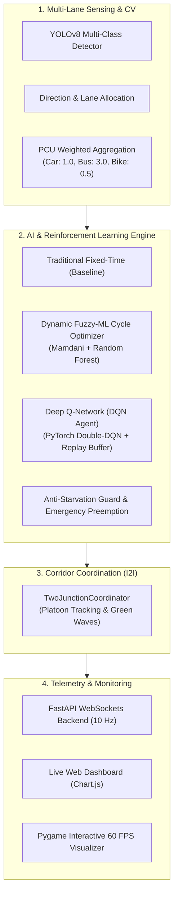

# 🚦 AI-Based Traffic Light Management System

[](https://github.com/ThimuthEXE/AI-Traffic-Light-Management-System/actions/workflows/ci.yml)
[](https://www.python.org/)
[](https://github.com/ThimuthEXE/AI-Traffic-Light-Management-System)
[](https://fastapi.tiangolo.com/)
[](https://pytorch.org/)
[](LICENSE)

> **Project:** Autonomous Multi-Modal Traffic Signal Optimization & Telemetry Platform  
> **Author:** Thimuth  

---

## 📌 Executive Summary

Urban traffic congestion results in severe delays, excessive fuel wastage, and increased emissions due to rigid, static fixed-time signal controllers. This project presents an end-to-end **AI-Driven Intelligent Traffic Light Management System** featuring Computer Vision, Dynamic Fuzzy-ML Optimization, Deep Reinforcement Learning (DQN), and Inter-Intersection (I2I) Green Wave Corridor Synchronization.

The system is evaluated via high-fidelity, micro-physics traffic simulations supporting both **Single 4-Way Intersections** and **Connected Multi-Junction Arterial Networks**.

---

## 🌟 Key Features & AI Architecture



### 1. Multi-Class Vehicle Detection & PCU Estimation
- Real-time video/camera detection using **YOLOv8** & **OpenCV**.
- Classifies vehicles: `Car (1.0 PCU)`, `Van (1.5 PCU)`, `Bus (3.0 PCU)`, `Truck (3.0 PCU)`, `Motorcycle (0.5 PCU)`, and `Ambulance (Emergency)`.
- Calculates lane-specific Passenger Car Unit (PCU) queues and arrival flow rates ($v/m$).

### 2. Tri-Modal Traffic Control Paradigms
1. **Mode 1: Traditional Fixed-Time Controller (Baseline):** Static cycle times ($24\text{s}$ green splits) mimicking conventional non-adaptive lights.
2. **Mode 2: Dynamic Fuzzy-ML Cycle Optimizer:** Mamdani Fuzzy Inference Engine augmented with Random Forest regression to dynamically balance green times ($8\text{s} - 38\text{s}$) with starvation prevention.
3. **Mode 3: Deep Reinforcement Learning (DQN):** Multi-objective Bellman RL agent trained with Experience Replay to optimize total network throughput and delay reduction.

### 3. Safety Guards & Emergency Handling
- **Anti-Starvation Safety Hard Ceiling:** Prevents minor approaches from waiting longer than $48\text{s} - 55\text{s}$ regardless of opposing traffic volume.
- **Emergency Ambulance Preemption:** Instantly preempts active phases to clear corridors for emergency vehicles.

### 4. Inter-Intersection (I2I) Green Wave Coordination
- Monitors arterial platoons traveling between connected junctions ($J_1 \leftrightarrow J_2$).
- Computes vehicle Arrival ETA ($\text{Distance} / \text{Speed}$) and coordinates downstream phase preemption to let platoons glide through multiple intersections without stopping.

---

## 📂 Repository Structure

```
AI-Traffic-Light-Management-System/
├── src/aitraffic/                     # Core Installable Python Package
│   ├── controllers/                   # Signal Controllers (Fixed, Fuzzy, ML Dynamic)
│   ├── rl/                            # PyTorch Deep Q-Network (DQN) Agent & Environment
│   ├── vision/                        # YOLOv8 Computer Vision Pipeline & Detection
│   ├── prediction/                    # Scikit-Learn Traffic Flow Forecasting Models
│   ├── simulation/                    # Shared Signal State Machines, Nodes & Coordinators
│   ├── utils/                         # PCU Aggregation, Metrics & Geometric Helpers
│   └── cli.py                         # Unified Command-Line Interface Engine
│
├── 1_single_junction/                 # Dedicated Single 4-Way Intersection System
├── 2_two_junction/                    # Dedicated 2-Junction Connected Corridor System
├── 3_four_junction/                   # Dedicated 4-Junction Grid System (2x2 Connected)
│
├── backend/                           # FastAPI REST & WebSocket Telemetry Server
│   ├── app.py                         # Application Entry Point & Telemetry Loop
│   ├── config.py                      # Server Configuration
│   ├── db_service.py                  # Database Layer (MongoDB & Local JSON Fallback)
│   ├── live_state_manager.py          # Real-time Intersection State Hub
│   └── routes/                        # Intersections, Predictions, Analytics API
│
├── frontend/                          # Interactive Web Telemetry Dashboard
│   ├── index.html                     # Live Control Dashboard UI
│   ├── styles.css                     # Dark-Themed Responsive Styles
│   └── app.js                         # WebSocket Consumer & Chart.js Visualizer
│
├── launchers/                         # Windows 1-Click Launchers (.bat files)
│   ├── open_dashboard.bat             # Dashboard Web Launcher
│   ├── run_four_junction_simulation.bat# 4-Junction Grid Launcher
│   ├── run_two_junction_simulation.bat# 2-Junction Corridor Launcher
│   ├── run_simulation.bat             # Single-Junction Launcher
│   ├── run_yolo_monitor.bat           # YOLOv8 Video Monitor Launcher
│   └── run_all_components.bat         # Full Stack Launcher
│
├── tests/                             # Automated Test Suites & Regression Verification
│   └── test_dashboard.py              # 15-Point REST API & WebSocket Test Suite
│
├── data/                              # Datasets, Sample Videos & Scientific Benchmark Reports
├── .github/workflows/ci.yml           # GitHub Actions Automated CI Workflow
├── pyproject.toml                     # Standard PEP 621 Package Specification
├── main.py                            # Master Interactive CLI Console
├── run.bat                            # Master 1-Click Interactive Windows Launcher
└── requirements.txt                   # Project Dependencies
```

---

## ⚡ Quick Start & Installation

### 1. Prerequisites
- **Python 3.10 or 3.11** installed.
- (Optional) NVIDIA GPU with CUDA for accelerated YOLOv8 / PyTorch inference.

### 2. Setup Virtual Environment & Install Package

```bash
# 1. Clone the repository from GitHub
git clone https://github.com/ThimuthEXE/AI-Traffic-Light-Management-System.git
cd AI-Traffic-Light-Management-System

# 2. Create and activate a virtual environment
# On Windows (PowerShell):
python -m venv venv
.\venv\Scripts\activate

# On macOS / Linux:
python3 -m venv venv
source venv/bin/activate

# 3. Install the package in editable mode with dependencies
pip install -e .
```

---

## 🚀 Running the System

### Option A: Master 1-Click Interactive Launcher
- 🎮 **Windows:** Double-click **`run.bat`** (or run `python main.py`).
- Presents an interactive master menu to launch any simulation, open the dashboard, or run benchmarks:
  ```text
  ================================================================================
     🚦 AITraffic v2.0 — Autonomous Traffic Management & Telemetry Platform
  ================================================================================
    [1] Run 4-Junction Grid Simulation (Synchronized 2x2 Network)
    [2] Run 2-Junction Corridor Simulation (Arterial Green Wave)
    [3] Run Single-Junction Simulation (4-Way Intersection)
    [4] Launch Web Dashboard & FastAPI Telemetry (Port 8000)
    [5] Launch YOLOv8 Video Traffic Monitor
    [6] Run Scientific Performance Benchmark Suite
    [7] Run Automated Regression & Verification Tests
    [0] Exit
  ================================================================================
  ```

### Option B: Command-Line Execution (CLI)

```bash
# Direct Simulation Launches
python main.py sim 4        # 4-Junction Grid Simulation
python main.py sim 2        # 2-Junction Connected Corridor Simulation
python main.py sim 1        # Single-Junction Simulation

# Web Dashboard & Telemetry Server
python main.py dashboard    # Launches FastAPI backend & opens browser

# YOLOv8 Computer Vision Video Monitor
python main.py vision

# Run Automated Test Suite
python main.py test

# Run Scientific Benchmarks
python main.py benchmark 4  # 4-Junction Grid Benchmark
python main.py benchmark 2  # 2-Junction Corridor Benchmark
python main.py benchmark 1  # Single-Junction Benchmark
```

---

## ⌨️ Interactive Simulation Controls

When running the interactive Pygame simulations, use the following hotkeys:

| Key | Action |
| :---: | :--- |
| `[1]` | Switch to **Mode 1: Traditional Fixed-Time Controller** |
| `[2]` | Switch to **Mode 2: Dynamic Fuzzy-ML Cycle Optimizer** |
| `[3]` | Switch to **Mode 3: Deep Reinforcement Learning (DQN)** |
| `[E]` | Inject an **Emergency Ambulance** with priority sirens |
| `[Space]` | **Pause / Resume** the simulation clock |
| `[R]` | **Reset** simulation state and performance metrics |
| `[N] / [S] / [E] / [W]` | Manually increase/decrease approach traffic inflow rates |

---

## 📊 Scientific Benchmark Summary

### 2-Junction Connected Grid (5 Simulated Hours / 18,000s)

| Metric | Traditional Fixed-Time | Dynamic Fuzzy-ML | Deep RL (DQN Agent) |
| :--- | :---: | :---: | :---: |
| **Arterial Rush Hour AWT (EB)** | $20.81\text{ s}$ | $22.02\text{ s}$ | **$13.55\text{ s}$ (Best)** |
| **Cross-Street Surge AWT (N/S)** | $18.85\text{ s}$ | $22.04\text{ s}$ | **$17.22\text{ s}$ (Best)** |
| **Total Cleared Vehicles** | $76,067\text{ veh}$ | **$76,063\text{ veh}$** | $75,922\text{ veh}$ |
| **Total Cleared PCU** | $94,219.0\text{ PCU}$ | **$94,224.4\text{ PCU}$** | $93,977.1\text{ PCU}$ |
| **Safety & Anti-Starvation** | Passive | **Hard Cap Ceiling (<55s)** | **Active Multi-Objective** |
| **Collision Probability** | **0.0%** | **0.0%** | **0.0%** |

*Full evaluation reports and high-resolution figures are located in [`data/simulation_reports/`](data/simulation_reports/).*

---

## 👤 Author & License

**Developer:** Thimuth ([@ThimuthEXE](https://github.com/ThimuthEXE))  
**Repository:** [AI-Traffic-Light-Management-System](https://github.com/ThimuthEXE/AI-Traffic-Light-Management-System)  
**License:** MIT License  
